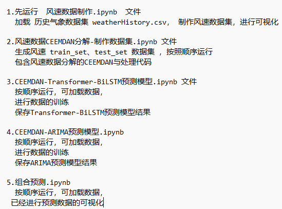
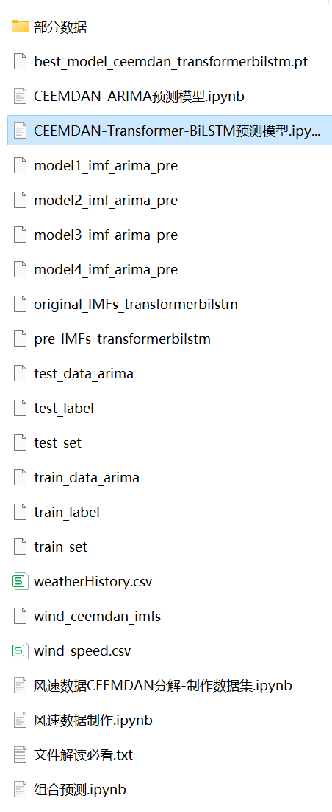

# CEEMDAN+(Transformer-BiLSTM+ARIMA) Combination Forecasting Model

The method of Comprehensive Ensemble Experience Mode Decomposition (CEEMDAN) and hybrid predictive models (Transformer-BiLSTM + ARIMA) is proposed to enhance the prediction performance of time series data. The core of this method lies in the use of CEEMDAN algorithm for decomposing the time series, followed by modeling the decomposed data using the Transformer-BiLSTM model and ARIMA model, and finally integrating the predictions from both models through an ensemble approach.
Include wind speed data, as well as the wind speed dataset and label set that have been generated and processed through CEEMDAN decomposition. The corresponding codes can be run, and there are also examples of CEEMDAN decomposition.
Transformer-BiLSTM + ARIMA model, with smaller MSE and MAE, has particularly noticeable effects.
Includes the code for data preprocessing of CEEMDAN, and complete Transformer-BiLSTM model prediction code, ARIMA prediction model code, visualization code.
Environment: Python 3.9
\n        \n  
\n        \n  

## Images

<!-- PAYMENT_BLOCK -->

## Get this dataset

- Payment link (Stripe): [Buy now](https://buy.stripe.com/3cs8yP7sY87d0vu9AB)
- Payment QR code: 

<!-- /PAYMENT_BLOCK -->
